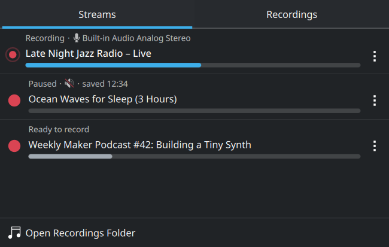
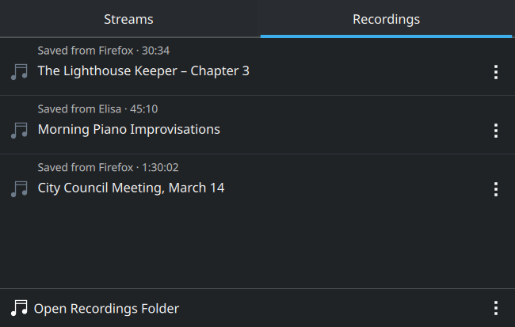

# Record What's Playing

Records the audio that applications play — a browser tab, a music player, a
call — on a KDE Plasma 6 desktop with PipeWire. Pick a stream in the system
tray widget and press record; you can mix in a microphone, pause and resume,
and silence the playback while it keeps recording. Recordings are saved as MP3.

<p align="center">
  
  
</p>

It has two parts:

- **grabd**: a Python service that runs in your session. It finds the playing
  streams, records them with ffmpeg and offers a D-Bus API
  (`org.grab.Recorder`).
- **The widget**: a Plasma system tray applet called "Record What's Playing"
  (`org.grab.recorder`), which talks to grabd.

## Requirements

- Arch Linux, or a derivative that uses pacman.
- KDE Plasma 6.
- PipeWire with pipewire-pulse and WirePlumber.

pacman installs all the runtime dependencies: python, python-dbus-next,
python-mutagen, ffmpeg, pipewire, pipewire-audio, pipewire-pulse, libpulse,
wireplumber, glib2, plasma-workspace, libplasma, kirigami and purpose.

To build the package you also need git and `base-devel` (for makepkg).

## Build

```sh
git clone https://github.com/kitaev/grab.git
cd grab
./build.sh
```

The script builds an Arch package from the **committed** `HEAD` into `dist/`,
for example `dist/grab-recorder-0.1.r56.g6b146b0-1-any.pkg.tar.zst`. If you
have uncommitted changes, it warns you and leaves them out. The version is
`0.1.r<commit count>.g<commit hash>`.

The package is `arch=any`, so a package built on one machine installs on any
other Arch machine. Copy the `.pkg.tar.zst` file over and install it as shown
below.

## Install

```sh
sudo pacman -U dist/grab-recorder-*.pkg.tar.zst
```

You can also build and install in one step with `./build.sh --install`.

After the first install:

1. The package restarts Plasma, and the widget appears in the system tray.
   If it doesn't, turn it on in
   **System Tray Settings → Entries**.
2. You don't have to start grabd yourself: D-Bus starts it as soon as the
   widget asks for it. To start it at login instead, run:

   ```sh
   systemctl --user enable grabd
   ```

### Upgrade

Install the new package with `pacman -U`. You don't need to restart anything
yourself:

- The package restarts Plasma for each logged-in user, so the new widget loads
  right away.
- A running grabd notices that its file was replaced. It restarts into the new
  version as soon as nothing is recording, paused, encoding or muted. Until
  then it keeps running the old version.

The only thing lost in that restart is a microphone or echo-cancellation choice
on a stream that isn't recording.

### Uninstall

```sh
systemctl --user disable --now grabd
sudo pacman -R grab-recorder
```

Uninstalling leaves your recordings where they are.

## What gets installed

| Path | What |
|---|---|
| `/usr/bin/grabd` | the service |
| `/usr/lib/systemd/user/grabd.service` | systemd **user** unit |
| `/usr/share/dbus-1/services/org.grab.Recorder.service` | D-Bus activation file, which starts the unit |
| `/usr/share/plasma/plasmoids/org.grab.recorder/` | the tray widget |

grabd runs as a systemd *user* service, not a system one, because it needs
things that only exist in your login session: your PipeWire graph, the session
D-Bus, your Music folder and your Trash.

## Settings

Right-click the tray icon and choose **Configure Record What's Playing…**.

**Save recordings in** is the folder for new recordings. By default this is
`grab/` inside your XDG music folder (`XDG_MUSIC_DIR` in
`~/.config/user-dirs.dirs`), usually `~/Music/grab`. Recordings already made
stay where they are, and the list shows the recordings in the chosen folder.

grabd keeps this setting itself, in `~/.config/grabd/settings.json`, so it
is the same for every copy of the widget. Setting `GRAB_OUTDIR` in the unit's
environment (`systemctl --user edit grabd`) changes the default folder.

## Removing recordings

The "⋮" menus move a recording's files to the Trash: *Move Recording to
Trash*, *Remove Entry and Move to Trash* and *Remove All Entries and Move to
Trash*. Hold **Shift** while the menu is open, as in Dolphin, and these items
change to delete the files permanently instead. Permanent deletes ask for
confirmation first. *Remove Entry* takes a recording off the list and keeps
its file. For a failed recording that means the lossless `.flac` it was
recorded into, which is kept next to the MP3s as a normal visible file.

## Sharing recordings

A recording's "⋮" menu has a **Share** submenu, the same one Dolphin shows.
KDE's Purpose framework provides it, so it lists whatever share targets are
installed: Send via Telegram, Send via Email, Send via Bluetooth, KDE Connect,
Nextcloud, Copy to Clipboard and so on. Send via Telegram opens Telegram
Desktop's own chat picker, so you choose the chat or group there. Targets that
need settings first, such as a Bluetooth device or a Nextcloud account, show
them in a dialog.

## How recordings are stored

While a stream is recording, grabd writes a hidden `.<name>.flac` file. The
MP3 is encoded from it when the recording is stopped or saved. The title,
date, app and microphone are stored in the MP3's tags, and grabd uses those
tags to list earlier recordings when it starts.

## Troubleshooting

To see grabd's log:

```sh
journalctl --user -u grabd -f
```

To check whether grabd is running and what state it is in:

```sh
busctl --user call org.grab.Recorder /org/grab/Recorder org.grab.Recorder1 GetState
```

The full D-Bus API is described at the top of `grabd`.

## Development

| Path | What |
|---|---|
| `grabd` | the service (single Python file) |
| `plasmoid/` | the widget (QML) |
| `grabd.service` | systemd user unit |
| `packaging/` | D-Bus activation file, PKGBUILD template, install hooks |
| `build.sh` | package build |
| `tests/` | tests for grabd and the widget |

To test the widget without installing it:

```sh
QT_FORCE_STDERR_LOGGING=1 plasmawindowed org.grab.recorder
```

For this to load your working copy, the widget must be found under
`$XDG_DATA_HOME/plasma/plasmoids/`. Point `XDG_DATA_HOME` at a temporary
directory that contains a copy or symlink of `plasmoid/`. Don't install it
user-locally with `kpackagetool6`: a user-local copy overrides the packaged
widget.

### Tests

```sh
tests/run.sh            # everything
tests/run.sh grabd      # grabd only
tests/run.sh qml        # the widget only
```

- **grabd** (`tests/grabd/`, Python's `unittest`): the tests load `grabd` as a
  module. Its folders go in a temporary directory, PipeWire is faked and
  `tests/grabd/fakebin/ffmpeg` stands in for ffmpeg. They don't touch your
  recordings or audio.
- **The widget** (`tests/qml/`, Qt 6's `qmltestrunner`, offscreen): the Shift
  menus, the Share submenu and the Delete All confirmation. The Share test
  needs Purpose's plugins installed.

The script exits non-zero if any test fails.
